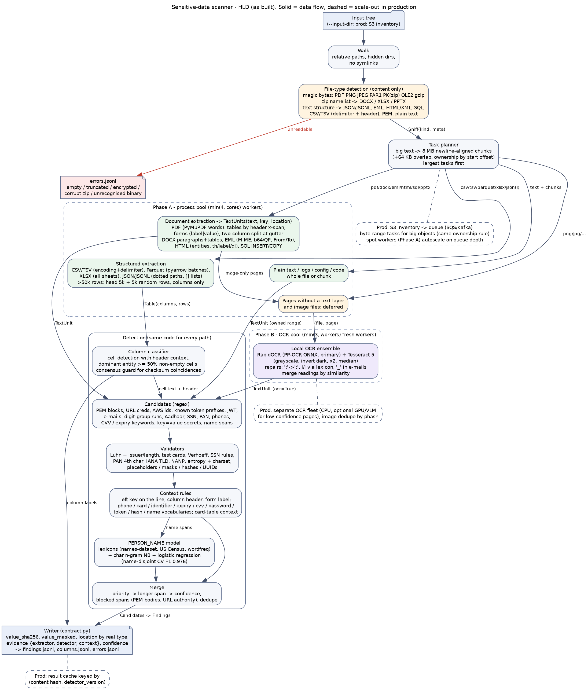

# DESIGN

## High-level design

It shows the pipeline exactly as built in `src/scanner/`.

1. **Type detection** (`filetype.py`). Files are recognised by content, never by extension: magic bytes (PDF, PNG, JPEG, Parquet, ZIP → DOCX/XLSX/PPTX by namelist, OLE2, gzip), then the structure of decoded text (JSON vs JSONL, MIME headers → EML before HTML, SQL, CSV/TSV by delimiter consistency plus a header-like first row). Unreadable files go straight to `errors.jsonl`.
2. **Task planning** (`pipeline.py`). Text files larger than 8 MB are split into newline-aligned byte ranges. Each task reads ±64 KB of overlap but keeps only candidates that *start* inside its own range, so a value is never missed at a boundary and never reported twice. The largest tasks are scheduled first.
3. **Phase A pool** (`min(4, cores)` workers). Extraction produces either `Table(columns, rows)` or `TextUnit(text, key, location)`:
   * Structured: CSV/TSV, Parquet, XLSX, JSON/JSONL as dotted paths. Tables over 50k rows are sampled (head plus random rows) and yield column labels only.
   * PDF layout from word boxes: table cells take their header from the header's x-span, form labels stay next to their values, and two-column pages are split at the gutter.
   * DOCX, EML (MIME-decoded, From/To), HTML (entities, `th`, `label`, `dl`), SQL INSERT/COPY with column context.
   * Pages without a text layer, and image files, are deferred to Phase B.
4. **Phase B OCR pool** (`min(3, workers)` fresh workers). RapidOCR (primary) plus Tesseract run on each page, followed by targeted repairs; the two readings are merged by similarity. OCR runs in its own phase so OCR models never sit in memory next to big-file buffers.
5. **Detection** (`detect/`) is identical for every path:
   * regex candidates;
   * validators (Luhn plus issuer/length, Verhoeff, SSN and PAN rules, IANA TLDs, NANP, entropy, placeholder/hash/UUID filters);
   * context rules (key on the same line, column header, form label);
   * a learned PERSON_NAME model (lexicons, character n-grams, logistic regression);
   * a merge step (priority, then span length, then confidence; blocked spans; dedupe).
   For tables, a column classifier labels the dominant entity (≥ 50% of non-empty cells).
6. **Writer** (`output.py`). Applies `contract.value_sha256`, masking, `location` by real file type, and evidence `{extractor, detector, context}` (labels and keys only, never values).

In production, the dashed boxes are what scales out: a queue of byte-range tasks over an S3 inventory, a separate OCR fleet, and a result cache keyed by content hash and detector version.

---

All numbers below are measured on this laptop: i7-1165G7 (4 cores / 8 threads), single-threaded per core.

| Work | Throughput per core |
|---|---|
| Logs / plain text | **1.8 MB/s** (153 MB in 84.9 CPU-s) |
| Large table (1M rows, sampled) | **≈ 2.8 s per file** (135 MB CSV or 108 MB Parquet) |
| Text-layer PDF pages | **≈ 395 pages/s** |
| OCR, RapidOCR alone | **2.1 s/page** |
| OCR, ensemble | **2.6 s/page** |
| DOCX / EML | 12 ms / 1 ms per file |

The hidden-scale run (1M-row CSV and Parquet, 150 MB log, 50 OCR pages) took **56.6 s with 4 workers, peaking at 1.75 GB** summed over the process tree.

## 1. Scale: 2 PB in S3 (80% logs/CSV, 15% documents/PDF, 5% images)

**Estimate.** Assumptions are stated explicitly; a cloud vCPU is taken as 0.75 of a laptop core.

| Slice | Assumption | Core-hours |
|---|---|---|
| Logs, 1.2 PB | full scan at 1.8 MB/s | 185k |
| | with a multi-pattern prefilter (Hyperscan/RE2 at ~1 GB/s; ≈99% of log lines are boilerplate, as in the dev log), detectors only on candidate lines | **≈ 2.5k** |
| CSV, 0.4 PB | ~4M files of ~100 MB; >50k rows sampled at ≈3 s each, plus 10% small tables scanned fully | ≈ 9k |
| Documents, 300 TB | ≈2·10⁹ pages; text-layer pages at 395/s | 1.4k |
| | 10% scanned pages at 2.1 s | 117k |
| Images, 100 TB | ≈3·10⁸ images; after 40% perceptual-hash dedupe, a 0.3 s text-region detector, then OCR on the ~50% that contain text | 75k |

* **Conservative total:** ≈390k core-h ≈ 520k vCPU-h ≈ **$6k on spot** ($0.012/vCPU-h) or ≈$23k on demand.
* **Optimised total:** with the log prefilter, ≈205k core-h ≈ **$3.3k**.
* **GPU OCR:** OCR is then ~95% of compute. PP-OCR on a spot T4 runs ≈30 pages/s, so ≈2.8k GPU-h ≈ $600 replaces ≈$2.5k of CPU OCR.
* **S3 requests:** ≈2·10⁹ GETs ≈ $800. Ranged GETs keep egress in-region (free).
* **Wall clock:** ≈6 days on 2,000 spot vCPUs for the optimised plan (≈11 days conservative), ≈1–2 days on 10,000.

**Skip, sample and deduplicate.**
* Dedupe by content: ETag plus size, or a sampled hash for multipart objects, within a tenant.
* Sniff from a 64 KB range GET and skip media and executables.
* Sample tables over 50k rows: Parquet footer plus a few row groups; CSV head plus random ranges.
* Gate OCR with a cheap text-region detector and image dedupe.
* Never sample logs: findings are per occurrence. Prefilter them instead.

**Distribution.**
* S3 Inventory → partitioner (size, sniffed type) → queue (SQS/Kafka) of small-file batches and byte-range tasks for big objects. Byte-range tasks use the same ownership rule as the chunker.
* Stateless spot workers (EKS/Batch) autoscale on queue depth. Tasks are idempotent, keyed by `(object version, detector_version)`, so they are safe under spot interruption.
* OCR runs on its own fleet, mirroring Phase B.
* Results land as partitioned Parquet with per-tenant rollups.

## 2. OCR strategy: vision LLM vs local OCR

**What local OCR gets right.** Measured value recall on dev images (share of gold values read verbatim): Tesseract 0.849, RapidOCR 0.924, and their union 0.958. The pipeline's OCR-path macro-F1 is 0.964 with the ensemble.

**What it can't fix.** The remaining dev errors are glyph-ambiguous random tokens: Arial `I`/`l`/`0` in `sk_test_…` and `xoxb-…`. A vision LLM sees the same ambiguous pixels and has no checksum to resolve them either.

**Where a vision LLM is worth it.** Handwriting, photos with perspective or glare, dense or complex forms and tables in photos, low resolution, and mixed scripts. These are cases where local OCR *confidence is low*. The cost is about 100–1000× local OCR: roughly $0.002–0.01 per page versus about $0.00002 for 2 s of CPU. It also has privacy implications, so it would need a private deployment or customer consent.

**Per-page cascade.**
1. Use the text layer if one exists (free).
2. Otherwise run a cheap text-region detector and skip pages with no text.
3. Run local OCR and record per-word confidence.
4. Escalate to a vision LLM only when OCR confidence is low **and** the page is likely sensitive (KYC/payment keywords or form labels in the OCR text, or a document-type classifier) **and** it isn't a duplicate (perceptual hash). Cap this with a per-tenant budget.

**Keeping OCR from slowing text scanning.** OCR runs in a separate phase or pool (Phase B here; a separate autoscaled fleet in production), fed by a queue of `(file, page)` tasks. Text findings are never blocked on OCR. Extraction is cached by image hash, so re-runs never re-OCR.

## 3. Incremental scans (weekly)

**Reuse a previous result** when `(bucket, key, version-id/ETag, size)` is unchanged **and** the `detector_version`, ruleset hash and model versions that produced it are unchanged.

**Rescan** when:
* The object changed: a new version or ETag, from the inventory diff.
* The detector changed in a way that affects the object. Map each change to the extractors and entities it touches. A new token prefix only needs **re-detection on cached extracted text**; an extractor change, such as PDF layout, needs re-extraction of that file type only.
* The previous attempt failed with a retryable error (timeout, crash). Encrypted files are retried only if a key is provided.

**Post-processing only** (no rescan) when only customer feedback or suppressions changed: re-apply them to the stored findings.

**Caches.**
* Extraction cache (text units and OCR text) keyed by content hash. OCR is the expensive step, so detector upgrades become cheap.
* Findings cache keyed by `(content hash, detector_version)`.

**Appends.** S3 objects are immutable, and rotated logs are new objects that dedupe by hash. On filesystems, track `(inode, size, mtime, hash of the last 64 KB)` and scan only the appended byte range with left overlap, using the same ownership rule as the chunker.

**Drift check.** Re-scan a random 1% weekly with the current version.

## 4. Precision at scale: a customer marks 200 findings as false positives

**Store** the feedback per tenant as `(value_sha256, entity, detector, context key/header, path pattern)`. Raw values are never stored.

**Immediate effect.** Exact suppression of those hash/location pairs for that tenant only.

**Generalising within the tenant.** Cluster the 200 by `(entity, detector, context key, path prefix)`. For example: "160 are CARD_NUMBER in column `loyalty_ref` of bucket X". Propose a tenant rule (`loyalty_ref` → identifier field), back-test it on the tenant's history and on the global golden set, then activate it after review.

**Per-tenant calibration** for scored entities (names, generic tokens and passwords): a small L2-regularised offset on the global logistic score, fitted on the tenant's feedback and shrunk towards zero, so a few labels can't swing it.

**Global learning** comes only from patterns seen across many tenants, for example the same key marked as an FP by at least N tenants. It ships as a new `detector_version` through the regression gates in §5. One customer's feedback therefore never changes another customer's results directly.

**When an LLM check per finding is worth it.** Only for context-dependent entities in the uncertain band: confidence 0.5–0.85 for PERSON_NAME in prose, generic API_TOKEN/PASSWORD, and bare phones. It is not worth it for checksum- or format-validated entities (cards, Aadhaar, AWS ids, PEM): their precision is already 1.00 on dev and synthetic.

The rule of thumb is to verify when P(FP) × analyst cost per false alarm (≈ $2) exceeds the LLM cost (≈ $0.001 with a small model and a short, **masked** context). Run the model locally or privately, never with raw values sent to a third party.

## 5. Regression safety: never silently drop recall

1. **Unit and property tests.** Today there are 177 tests: validators, routing, chunk boundaries, context rules, merge, extractors, the contract, and cross-platform behaviour. Generators plant values in every format and at chunk boundaries, and must reach 100% recall.
2. **Golden sets in CI.** The dev set, the synthetic hidden-like set (`make_synthetic.py`), the hidden-scale set (`make_perf_data.py`), per-format fixtures, and anonymised customer-approved samples. CI runs `starter/evaluate.py` plus `scripts/analyze_errors.py` and fails if any path, entity or slice loses more than 0.5 pt of recall, or a new FP cause appears.
3. **Differential testing.** Run old and new detector versions on a large unlabelled corpus, using cached extraction, and diff the findings. Every lost finding must be explained and approved; reviewers see masked values and context.
4. **Staged rollout.** Shadow mode, then canary tenants. Monitor findings per entity per TB scanned for each tenant and format, and alert on drops.
5. **Traceability.** `detector_version` is stamped on every finding, which enables targeted rescans and rollback.
6. **Pinned extraction stack.** OCR, PDF and Parquet library versions are pinned, with snapshot tests of extracted text: an extractor upgrade is a recall risk too.
